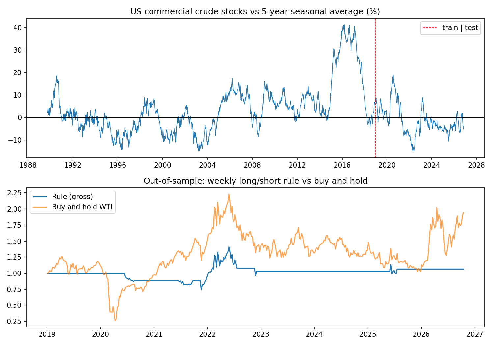

# US crude oil inventories vs WTI returns

Do weekly US commercial crude oil inventories, measured against their seasonal norm, help predict WTI crude oil returns?

**Short answer: not reliably.** In an out-of-sample test the relationship was statistically weak and pointed the opposite way to the textbook idea, and a simple rule built on it underperformed buy and hold.

Author: Felix Wendeling (LSE, BSc Data Science). November 2026. Educational research, not investment advice.

## Key results

Data: EIA weekly US commercial crude stocks excluding the SPR (series WCESTUS1) and WTI spot prices. Train: before 2019. Test: from 2019 onwards. Returns are gross of costs.

**Regression of forward WTI return on the inventory gap** (Newey-West / HAC standard errors):

| Horizon | Slope | t-stat | p-value | Out-of-sample correlation | Out-of-sample hit rate | n train | n test |
| --- | --- | --- | --- | --- | --- | --- | --- |
| 1 week | 0.019 | 1.64 | 0.100 | 0.097 | 53.5% | 1,523 | 406 |
| 4 weeks | 0.079 | 1.76 | 0.078 | 0.171 | 52.6% | 1,523 | 403 |

**Weekly long/short rule** (long when inventories are unusually low, short when unusually high, |z| > 1), test period:

| | Annualised return* | Sharpe | Max drawdown |
| --- | --- | --- | --- |
| Rule | 2.6% | 0.14 | -31.7% |
| Buy and hold WTI | 21.1% | 0.42 | -79.3% |

The rule held a position in 65 of 406 test weeks. *Annualised return is the average weekly return multiplied by 52, not a compounded figure.



### What this means

- **No statistically significant relationship at the 5% level** (p = 0.100 for 1 week, 0.078 for 4 weeks).
- **The sign is positive**: inventories above the seasonal norm were followed by slightly higher returns, the opposite of the usual "high stocks are bearish" assumption. For scale, the 1-week slope implies a 10% inventory gap goes with roughly 0.2% higher next-week return, which is not distinguishable from zero.
- **Out-of-sample hit rates are close to a coin flip.** They have not yet been compared with the share of up weeks in the test period (see below).
- **The rule did not beat buy and hold** before costs, and spent most of the time out of the market.

Possible explanations, none of which I have tested: the seasonal norm is public information and likely already priced in, the 2020 extremes distort the sample, or the effect is simply small relative to price noise.

## Method

1. **Seasonal norm.** For each week, the average inventory for the same ISO week over the previous five years only (the current year is excluded, so nothing from the future leaks in). The signal is the percentage gap between current stocks and that norm.
2. **Timing.** EIA publishes on Wednesday for the week that ended the previous Friday, so a signal is only usable five days after its date. Entry is the first WTI price on or after the release date. Using the Friday price would be a look-ahead bias.
3. **Forward returns** over 1 and 4 weeks. Observations where the entry or exit price is zero or negative are dropped, because WTI spot traded below zero in April 2020, which breaks percentage returns.
4. **Regression.** Forward return on the inventory gap, with Newey-West (HAC) standard errors because the 4-week returns overlap.
5. **Out-of-sample test.** Fit before 2019, then measure correlation and hit rate from 2019 onwards.
6. **Simple rule.** An expanding-window z-score of the gap (only past information): long when below -1, short when above +1, flat otherwise. Weekly holding period, gross of costs, compared with buy and hold.

## Run it

```bash
pip install -r requirements.txt
python crude_inventory_signal.py
```

The script downloads the data from the US Energy Information Administration (no API key needed) and writes `results.md` and `charts.png`. Results will shift slightly as new data is published; the numbers above were generated in November 2026.

**In Google Colab:** run `!pip install statsmodels xlrd` in a first cell if needed, paste the script into a second cell and run it. Output files appear in the `/content` folder.

**If a download is blocked**, download the two series by hand from EIA (weekly US commercial crude stocks excluding SPR, and daily WTI spot price; FRED's `DCOILWTICO` also works for prices), save them as `stocks.xls` and `prices.xls` (`.xlsx` or `.csv` also work) next to the script, and run it again. Local files are used first.

## Limitations

- Returns are gross of transaction costs, slippage, roll costs and financing. WTI spot is not directly tradable.
- One market, one signal and one split date. Results may be sensitive to the 2019 split and the |z| > 1 threshold, and I have not yet tested that.
- The test period includes the extreme moves of 2020.
- Release dates occasionally shift by a day around holidays, which the script does not model.
- Weekly figures can be revised, and the script uses the latest revised values.
- A significant in-sample result would not, on its own, show a tradable edge. Here there was not even a significant result.

## Not yet done (next steps)

- Compare the hit rates with the base rate (the share of test weeks with positive returns).
- Robustness checks: different split years, different z-thresholds, and excluding 2020.
- Test inventory *surprises* against analyst expectations, which may carry more information than the gap to a public seasonal norm.
- Repeat for natural gas storage, which has a stronger seasonal pattern.

## Files

| File | What it is |
| --- | --- |
| `crude_inventory_signal.py` | Full analysis: data loading, features, regression, out-of-sample test, rule and charts |
| `results.md` | Generated results tables |
| `charts.png` | Inventory gap over time and the rule versus buy and hold |
| `requirements.txt` | Python dependencies |
